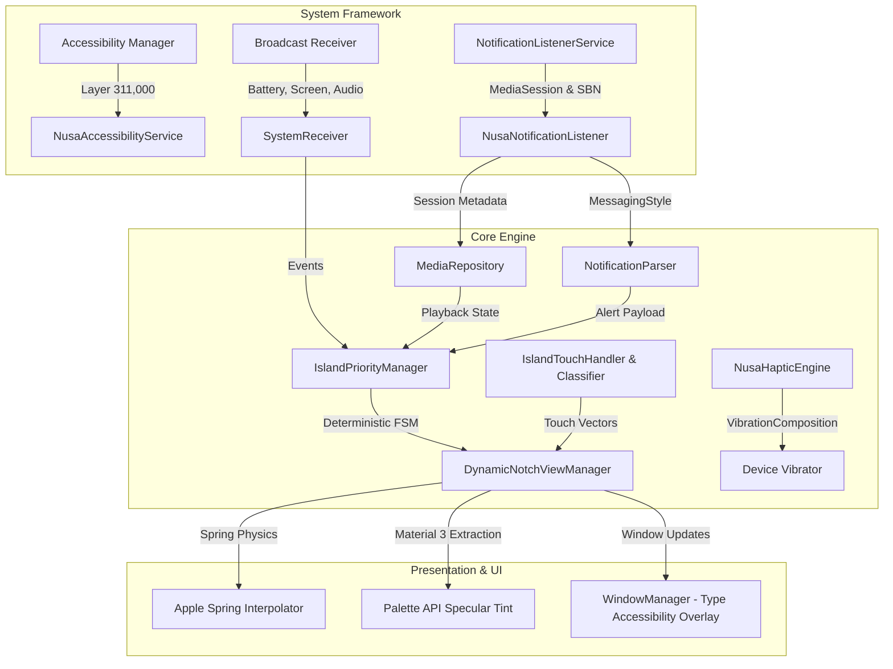

# 🏛️ Architecture & System Design — Nusa Dynamic Notch

Nusa Dynamic Notch is a production-grade, low-latency floating status bar overlay engine developed for the **Xiaomi Redmi Note 13 Pro 5G** (HyperOS / Android 14) and modern Android devices. It implements Apple Dynamic Island interaction mechanics, fluid physics, and deterministic state orchestration with zero memory leaks and sub-millisecond touch dispatch.

---

## 1. High-Level Component Architecture



---

## 2. WindowManager Layering Deep-Dive

On Android (specifically Xiaomi HyperOS / MIUI), the system `StatusBar` and `NotificationShade` are rendered on high window base layers:

| Window Type | Constant Value | Base Layer (`mBaseLayer`) | Touch Pass-Through Behavior |
| :--- | :--- | :--- | :--- |
| `TYPE_APPLICATION_OVERLAY` | `2038` | `~21,000` | Sits **below** the HyperOS StatusBar (`151,000`). Touches over the status bar are consumed by SystemUI and never reach the application overlay. |
| `TYPE_STATUS_BAR` | `2000` | `151,000` | Controlled exclusively by `com.android.systemui`. |
| `TYPE_ACCESSIBILITY_OVERLAY` | `2032` | **`311,000`** | Sits **above** the HyperOS StatusBar (`151,000`). Directly intercepts touch events at `(x, y)` coordinates over the display cutout before SystemUI consumes them. |

### Layout Flags & Cutout Display Optimization
```kotlin
params = WindowManager.LayoutParams(
    targetW,
    targetH,
    WindowManager.LayoutParams.TYPE_ACCESSIBILITY_OVERLAY,
    WindowManager.LayoutParams.FLAG_NOT_FOCUSABLE or
    WindowManager.LayoutParams.FLAG_NOT_TOUCH_MODAL or
    WindowManager.LayoutParams.FLAG_LAYOUT_IN_SCREEN or
    WindowManager.LayoutParams.FLAG_LAYOUT_NO_LIMITS or
    WindowManager.LayoutParams.FLAG_WATCH_OUTSIDE_TOUCH or
    WindowManager.LayoutParams.FLAG_SPLIT_TOUCH,
    PixelFormat.TRANSLUCENT
).apply {
    gravity = Gravity.TOP or Gravity.CENTER_HORIZONTAL
    x = 0
    y = dpToPx(yOffsetDp)
    if (Build.VERSION.SDK_INT >= Build.VERSION_CODES.P) {
        layoutInDisplayCutoutMode = WindowManager.LayoutParams.LAYOUT_IN_DISPLAY_CUTOUT_MODE_ALWAYS
    }
}
```

---

## 3. Finite State Machine (FSM) & Preemption Precedence Matrix

To prevent transient lockups (e.g. notifications getting permanently stuck on screen or audio player opening unexpectedly), the system is governed by a **Priority Preemption Engine**:

| State | Priority Rank | Preemption Capability | Behavior & Auto-Dismissal |
| :--- | :---: | :--- | :--- |
| **`CALL`** | `100` | Preempts all states | Persistent while call is active. |
| **`NOTIFICATION`** | `90` | Preempts Music, Charging, Pet | Transient: Auto-dismisses after 4.5s back to baseline. |
| **`RINGER`** | `85` | Preempts Music, Charging, Pet | Transient: Auto-dismisses after 2.5s back to baseline. |
| **`CHARGING`** | `80` | Preempts Music, Pet | Transient: 3.5s expanded -> 2.5s compact -> reverts to baseline. |
| **`MUSIC`** | `50` | Preempts Pomodoro, Pet | Persistent while media session is active / playing. |
| **`POMODORO`** | `40` | Preempts Pet | Persistent while timer is running. |
| **`MINIMAL`** | `30` | Parallel accessory pill | Secondary bubble for multi-tasking. |
| **`PET`** | `10` | Baseline idle state | Default resting state; winks on tap, expands on swipe. |

---

## 4. Touch Vector & Velocity Gesture Recognition

Fast flick gestures on small pills (36dp height) often cross the view boundary before `ACTION_UP`, causing the WindowManager to dispatch `ACTION_CANCEL`. Nusa implements unified trajectory analysis:

```kotlin
val gesture = IslandGestureClassifier.classify(
    startX, startY, event.rawX, event.rawY, duration, isExpanded
)
```

- **Horizontal Swipe Left (`dx < 0`, `absDx > 35px`, `absDx > absDy * 1.2f`):** Triggers `MediaController.skipToNext()` with haptic click.
- **Horizontal Swipe Right (`dx > 0`, `absDx > 35px`, `absDx > absDy * 1.2f`):** Triggers `MediaController.skipToPrevious()` with haptic click.
- **Vertical Swipe Down (`dy > 25px`, `dy > absDx`):** Expands Dynamic Island into interactive widget.
- **Vertical Swipe Up (`dy < -25px`, `absDy > absDx`):** Collapses expanded card back to compact pill.
- **Short Tap (`absDx < 30px`, `absDy < 30px`, `duration < 500ms`):**
  - In `PET`: Playful rubber-band double-eye wink (no music popups).
  - In `MUSIC`: Direct launch of active player (Spotify / YouTube).
  - In `NOTIFICATION`: Dispatches notification `PendingIntent` and dismisses banner.
- **Long Press (`duration >= 500ms`):** Expands the interactive widget.

---

## 5. Performance, Memory & Battery Optimization

1. **Zero Static Memory Leaks:** Decoupled `NusaHapticEngine`, `IslandPriorityManager`, and lifecycle observers using `ApplicationContext`.
2. **Screen-Off Zero-Cycle Sleep:** On `ACTION_SCREEN_OFF`, all animators, progress runnables, and visualizers are suspended immediately, achieving 0% idle CPU and battery drain.
3. **120Hz Fluid Motion:** Hardware-accelerated rendering using Apple iOS cubic-bezier spring curves `(0.22, 1.0, 0.36, 1.0)`.
4. **Material 3 Palette Tinting:** Async palette extraction from album art dynamically styles the specular ambient outline (`vIslandStroke`).
